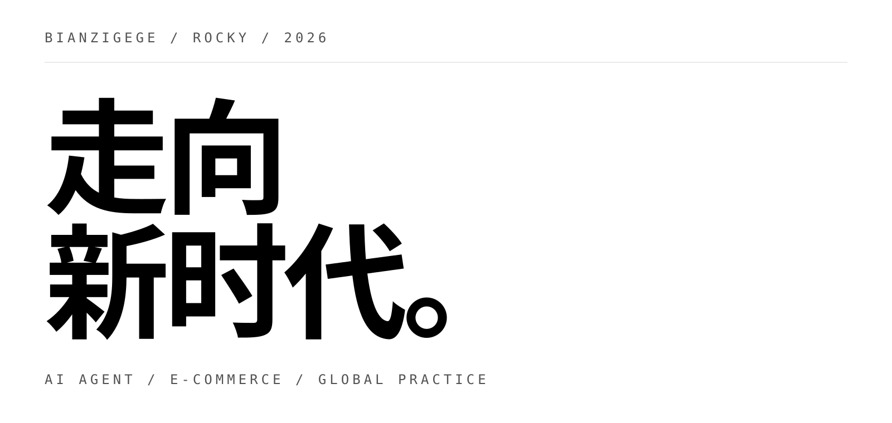

  

<table>
  <tr>
    <td width="72%" valign="top">
      
<strong>AI Agent × 电商增长 × 品牌出海实践者。</strong>

      
用 AI 重构电商内容生产与商业增长流程。曾负责小红书商家赋能业务，长期研究 AI Agent、短视频营销、跨境电商。

      
这里放的东西只有一个标准：能跑起来，能验收。

    </td>
    <td width="28%" align="right" valign="top">
      
    </td>
  </tr>
</table>

## 正在做

- **[开口泰 · 安心游泰国](https://github.com/bianzigege/kaikoutai-anxin)** — 泰国旅行翻译与防坑助手：拍一下看懂、实时同传、断网也能用。2026 飞猪 AI 旅行创新大赛参赛作品。[在线体验 ↗](https://bianzithai.pages.dev/trip)
- **[MacSweeper](https://github.com/bianzigege/MacSweeper)** — 安全、透明、免费的 Mac 垃圾清理工具。只移到废纸篓，从不直接删除；不联网、不收集。原生 SwiftUI。

## 代表作

| 项目 | 一句话 | 方向 | 试用 |
|---|---|---|---|
| [千川素材结构拆解 Skill](https://github.com/bianzigege/qianchuan-material-breakdown-skill) | 把一条短视频拆成镜头、口播、卖点卡片和仿拍方案，归档到飞书 / 钉钉 | 电商 · 短视频 | [百炼版 ↗](https://github.com/bianzigege/qianchuan-material-breakdown-skill-bailian) |
| [MacSweeper](https://github.com/bianzigege/MacSweeper) | 只清会自动重建的缓存，所有操作可撤销的 Mac 清理工具 | macOS 工具 | [下载 ↗](https://github.com/bianzigege/MacSweeper/releases) |
| [开口泰 · 安心游泰国](https://github.com/bianzigege/kaikoutai-anxin) | 不靠中间人，直接跟泰国人打交道的旅行助手 | AI 旅行 | [在线 ↗](https://bianzithai.pages.dev/trip) |
| [Avatar Sticker Pack](https://github.com/bianzigege/avatar-sticker-pack) | 同一人设生成真人比例 + Q 版两套表情包贴纸 | 图像 Skill | [下载 Skill ↗](https://github.com/bianzigege/avatar-sticker-pack/releases) |
| [AI 浓度检测器](https://github.com/bianzigege/ai-density-detector) | 浏览器本地识别中文文案的 AI 味，只告诉你哪里像、为什么、怎么改 | 写作工具 | [在线 ↗](https://ai-density-detector.poodles-gasses-4y.chatgpt.site) |
| [拆封 CoverLab](https://github.com/bianzigege/coverlab-editor) | 把参考封面拆成可编辑图层，OCR 识字、换字换色、导出 | 封面工具 | [在线 ↗](https://bianzigege.github.io/coverlab-editor/) |

## 更多

  
<strong>Skill 与工作法</strong>（5）

   

- [千川素材结构拆解 · 百炼版](https://github.com/bianzigege/qianchuan-material-breakdown-skill-bailian) — 阿里云百炼 qwen3.7-plus 多模态理解版
- [霓码重构 Neon Recode](https://github.com/bianzigege/neon-recode) — 把真实影像重新编码成蓝白霓光
- [气旋三阶 Cyclone Morph](https://github.com/bianzigege/cyclone-morph-skill) — 一张图分三阶变成卫星风暴
- [OpenWhip Skill](https://github.com/bianzigege/openwhip-skill) — 等待 AI 时的多色鞭子反馈动画
- [多 Agent 信箱协作工作法](https://github.com/bianzigege/multi-agent-inbox-workflow) — 让多个 Agent 少失忆、少传话、能逐项验收

  
<strong>浏览器小工具</strong>（4）

   

- [墨题 · 艺术字与手写封面](https://github.com/bianzigege/moti-cover-studio) — 可商用字体、手写稳笔，本地导出高清 PNG。[在线 ↗](https://bianzigege.github.io/moti-cover-studio/)
- [OpenWhip Creator](https://github.com/bianzigege/openwhip-creator) — 上传一张图，做成等待 AI 时的互动反馈角色。[在线 ↗](https://bianzigege.github.io/openwhip-creator/)
- [知乎内容研究与写作助手](https://github.com/bianzigege/zhihu-content-lab) — 选题、账号匹配、回答拆解，本地优先
- [微博内容研究与运营助手](https://github.com/bianzigege/weibo-content-lab) — 热搜与账号研究，人工确认后才发布

  
<strong>分享</strong>（1）

   

- [抖音推荐算法底层逻辑分享](https://github.com/bianzigege/douyin-algorithm-logic-sharing) — 用一次午休下单路径，拆解推荐机制、直播转化与人性设计

## 找到我

**辫子哥哥** — [小红书](https://www.xiaohongshu.com/user/profile/5c91c2850000000010010c50) · [抖音](https://v.douyin.com/9k7yYufn6yA/) · [知乎](https://www.zhihu.com/people/dong-hao-an) · [微博](https://www.weibo.com/u/6281948662)

  
公众号｜辫子哥哥 · 扫码关注

   
  

  

